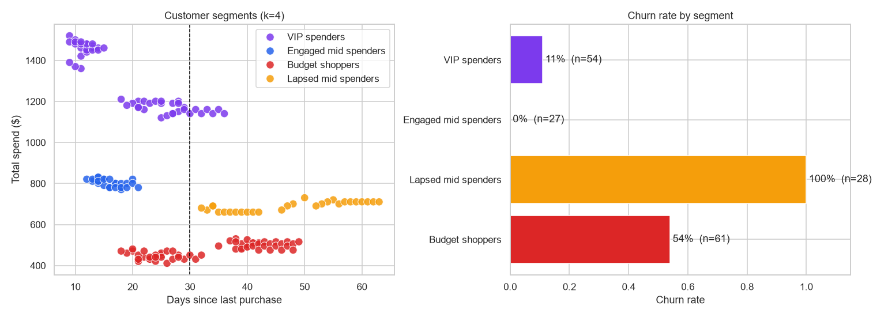
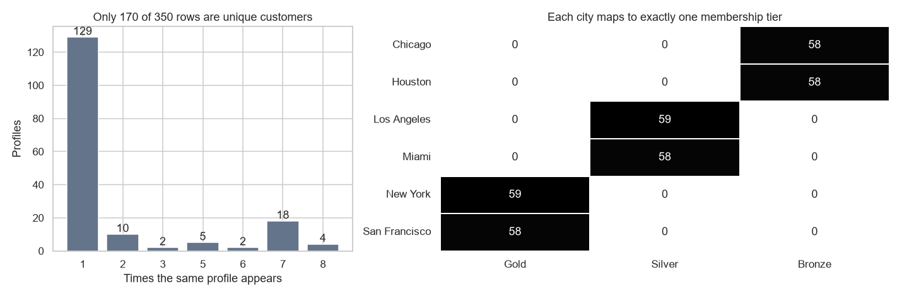
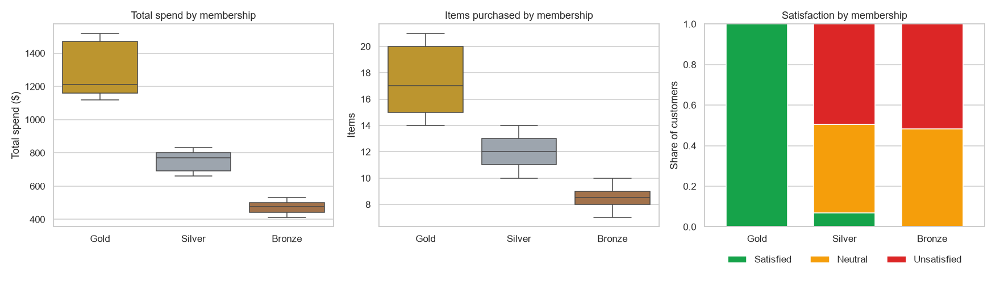
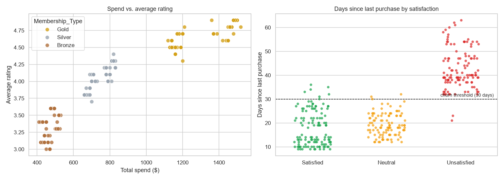
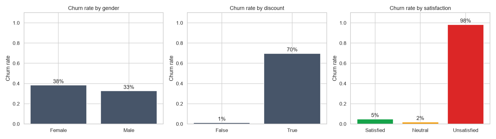
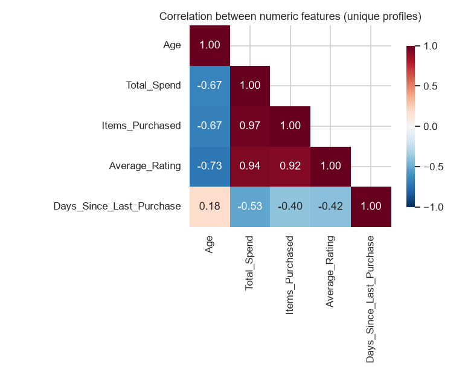
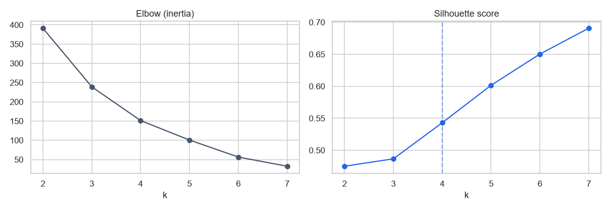
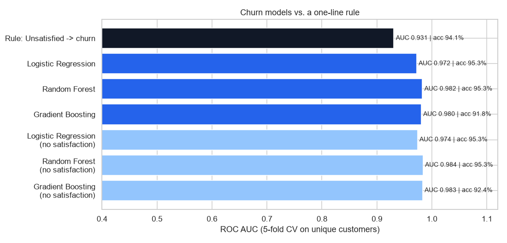
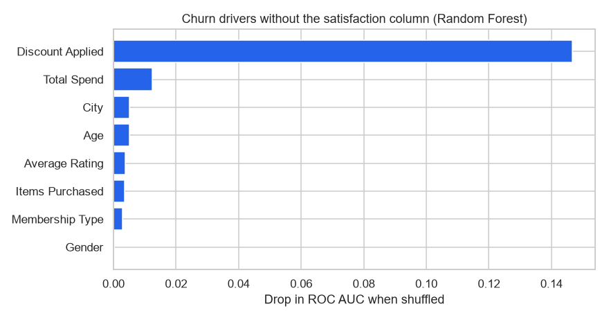

# E-commerce Customer Behaviour: EDA, Segmentation & Churn

An end-to-end analysis of 350 e-commerce customers. It covers who they are and how they spend, which natural customer segments exist (K-Means), and whether we can predict which customers are about to churn. It also checks honestly whether machine learning beats a simple business rule.



## Key findings

1. **Audit before you model.** Only **170 of the 350 rows are unique customers**; the rest are duplicated profiles with new IDs. `City` also maps one-to-one onto membership tier. All modelling uses deduplicated customers, so no customer appears in both training and test data.
2. **Gold members spend about 2.8 times more** than Bronze members ($1,311 vs. $473 on average), buy twice as many items, are all satisfied, and rarely churn.
3. **Satisfaction is the churn signal.** Every *Unsatisfied* customer churned. The one-line rule **"Unsatisfied → churn" is 94.1% accurate**, and the best ML models only reach **95.3% (ROC AUC 0.98)**. The practical recommendation is to act on satisfaction scores first.
4. **Discounts mark at-risk customers.** About **70% of customers who received a discount churned**, against about 1% of those who didn't. Without satisfaction data, *discount applied* is by far the strongest predictor. Discounts here look like a reaction to disengagement rather than a cure.
5. **Four actionable segments:**

| Segment | Customers | Avg. spend | Avg. days inactive | Churn rate | Tier |
|---------|----------:|-----------:|-------------------:|-----------:|------|
| VIP spenders | 54 | $1,303 | 20 | 11% | Gold |
| Engaged mid spenders | 27 | $801 | 16 | 0% | Silver |
| Lapsed mid spenders | 28 | $689 | 47 | **100%** | Silver |
| Budget shoppers | 61 | $473 | 33 | 54% | Bronze |

Silver members split into two very different groups: an engaged one that never churns, and a lapsed one that always does. Older Bronze budget shoppers are a 50/50 risk, which makes them the best target for retention campaigns.

## Data-quality audit



## Exploratory analysis





<p>
  
</p>

<p>
  
  
</p>

## Churn prediction

**Churn** is defined by recency: no purchase in more than 30 days. `Days_Since_Last_Purchase` defines the target, so it's removed from the features. Three models are evaluated with stratified 5-fold cross-validation on the 170 unique customers, and compared with the one-line rule, both with and without the satisfaction column.



| Model | Features | Accuracy | Churners caught | ROC AUC |
|-------|----------|---------:|----------------:|--------:|
| Rule: Unsatisfied → churn | satisfaction only | 94.1% | 88.1% | 0.931 |
| Logistic Regression | all | 95.3% | 88.1% | 0.972 |
| Random Forest | all | 95.3% | 88.1% | 0.982 |
| Gradient Boosting | all | 91.8% | 92.5% | 0.980 |
| Random Forest | without satisfaction | 95.3% | 88.1% | 0.984 |



### About the original 98% result
An earlier version of this analysis reported about 98% accuracy using a random split of all 350 rows. Because about half the rows are duplicates, identical customers appeared in both the training and test sets. Evaluating on unique customers gives the more trustworthy figure of about 95%.

## Getting started

```bash
git clone https://github.com/arslanahmedbhutto/ecommerce-customer-behavior.git
cd ecommerce-customer-behavior
pip install -r requirements.txt
```

Download the dataset (see [data/README.md](data/README.md)), save it as `data/ecommerce_customer_behavior.csv`, then run `customer_behavior_analysis.ipynb`. It takes under a minute.

## Project structure

```
ecommerce-customer-behavior/
├── customer_behavior_analysis.ipynb  # Audit, EDA, segmentation, churn models
├── results/
│   ├── churn_model_results.csv       # Cross-validated model scores
│   ├── customer_segments.csv         # Segment profiles
│   └── summary.json
├── data/README.md                    # Dataset source and columns
└── screenshots/
```

## Tech stack

Python · pandas · NumPy · scikit-learn · Matplotlib · Seaborn

## Note on the data

This dataset appears to be **synthetic**: there are exact duplicate profiles, a one-to-one mapping between city and membership tier, and near-deterministic links between satisfaction and churn. The methods here (auditing, deduplicated evaluation, rule baselines, segmentation) carry over to real data, but the specific numbers shouldn't be read as real-world consumer behaviour.
